# 🧑‍💼 AskHR: Automatize tarefas de RH com Agentic AI

## Sumário

- [Descrição do caso de uso](#descrição-do-caso-de-uso)
- [Pré-requisitos](#pré-requisitos)
- [Materiais do laboratório](#materiais-do-laboratório)
- [Instruções](#instruções)
  - [1. Abrir o watsonx Orchestrate](#1-abrir-o-watsonx-orchestrate)
  - [2. Criar o Agente de RH](#2-criar-o-agente-de-rh)
  - [3. Configurar estilo, boas-vindas e atalhos](#3-configurar-estilo-boas-vindas-e-atalhos)
  - [4. Adicionar a base de conhecimento](#4-adicionar-a-base-de-conhecimento)
  - [5. Adicionar as ferramentas (OpenAPI)](#5-adicionar-as-ferramentas-openapi)
  - [6. Definir as instruções do agente](#6-definir-as-instruções-do-agente)
  - [7. Testar o agente no Draft Preview](#7-testar-o-agente-no-draft-preview)
  - [8. Publicar o agente (Deploy)](#8-publicar-o-agente-deploy)
  - [9. Testar o agente no Chat](#9-testar-o-agente-no-chat)

## Descrição do caso de uso

Este caso de uso tem como objetivo desenvolver e implementar um agente AskHR utilizando o <b>IBM watsonx Orchestrate</b>, conforme ilustrado no diagrama de arquitetura do [README](../README.md). Esse agente vai permitir que os colaboradores interajam com os sistemas de RH e acessem informações de forma simples e eficiente, usando IA conversacional.

No laboratório, vamos construir um agente de RH no <b>watsonx Orchestrate</b>, aproveitando ferramentas e conhecimento externo para se conectar a um sistema de Gestão de Capital Humano (HCM) simulado. Esse agente será capaz de recuperar informações relevantes de documentos para responder às perguntas dos usuários e também permitir que eles visualizem e gerenciem seus próprios perfis.

## Pré-requisitos

- Verifique com seu instrutor se **todas as aplicações** estão funcionando antes de continuar.
- Confirme se você tem acesso ao ambiente TechZone correto para este laboratório.
- Baixe os arquivos listados em [Materiais do laboratório](#materiais-do-laboratório).

## Materiais do laboratório

Todos os arquivos do lab estão na pasta [`lab-data`](lab-data):

| Arquivo | Para que serve |
| --- | --- |
| [`Employee-Benefits_ptbr.pdf`](lab-data/Employee-Benefits_ptbr.pdf) | Documento de benefícios da empresa, usado como **base de conhecimento** (passo 4). |
| [`hr.yaml`](lab-data/hr.yaml) | Especificação OpenAPI do sistema de RH simulado, usada para criar as **ferramentas** (passo 5). |
| [`users_data.xlsx`](lab-data/users_data.xlsx) | Lista de funcionários cadastrados no simulador. Escolha **um nome** para usar nos testes. |

> [!TIP]
> Para baixar um arquivo no GitHub, abra o link e clique no ícone de download (**Download raw file**). As versões originais em inglês estão em [`lab-data/en`](lab-data/en).

## Instruções

### 1. Abrir o watsonx Orchestrate

1. Faça login na IBM Cloud ([cloud.ibm.com](https://cloud.ibm.com)). No menu superior esquerdo, abra a **Resource list** e expanda a seção **AI / Machine Learning**. Clique no serviço do **watsonx Orchestrate** (produto `watsonx Orchestrate`):

   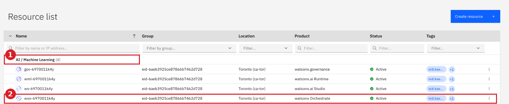

2. Clique no botão azul **Launch watsonx Orchestrate**:

   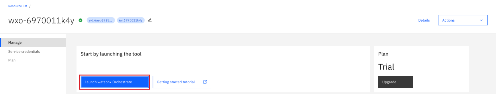

Bem-vindo ao <b>watsonx Orchestrate</b> 💙

### 2. Criar o Agente de RH

1. Na página inicial (**Home**), clique em **Create agent**:

   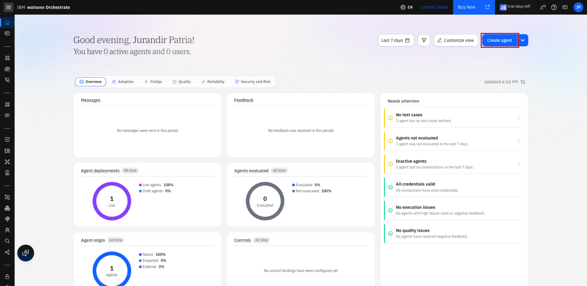

2. Na janela **Create an agent**, mantenha o workspace **Global workspace** e clique em **Create from scratch**:

   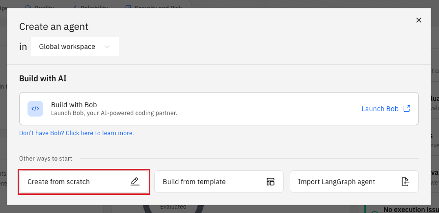

   > [!NOTE]
   > Nas versões atuais do watsonx Orchestrate o agente é criado na hora, com o nome provisório **Untitled Agent**, e a tela de configuração já abre na aba **Build**. Todas as alterações são salvas automaticamente.

3. Na seção **Profile** da aba **Behavior**, preencha:

   - **Agent name** (1):

     ```
     Agente de RH
     ```

   - **Description** (2):

     ```
     Você é um agente que lida com as dúvidas dos funcionários sobre RH. Você fornece respostas curtas e diretas, com no máximo 200 palavras. Você pode ajudar os usuários a verificar os seus dados de perfil, consultar o saldo de folgas mais recente, atualizar cargo ou endereço e solicitar folgas. Você também pode responder a perguntas gerais sobre os benefícios da empresa.
     ```

   - **Model**: mantenha o modelo padrão, não é necessário alterar.
   - **Instructions**: deixe em branco por enquanto. Vamos preencher no [passo 6](#6-definir-as-instruções-do-agente), depois de adicionar conhecimento e ferramentas.

   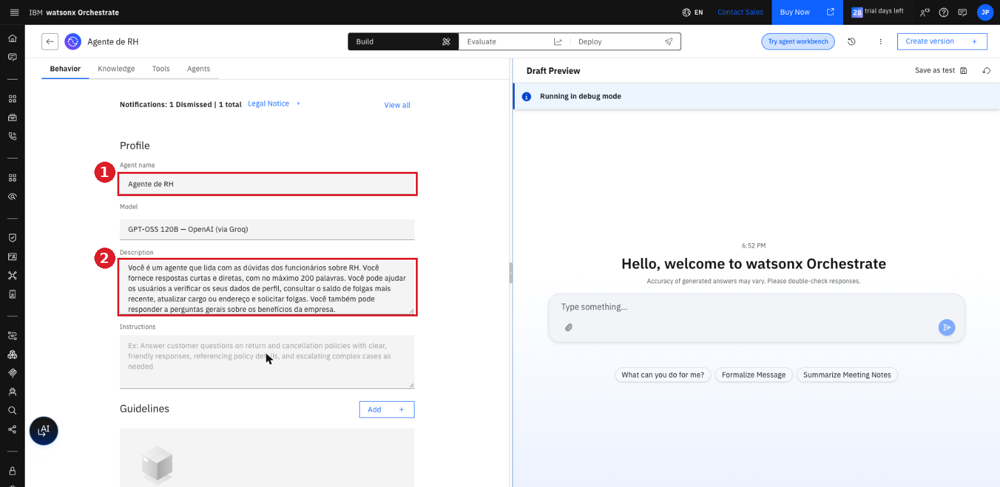

### 3. Configurar estilo, boas-vindas e atalhos

1. Role a aba **Behavior** até o final e expanda **Advanced settings**.

   - Em **Agent style** (1), mantenha **ReAct Core** (recomendado).
   - Em **Welcome message and starter prompt**, clique em **Edit** (2).

   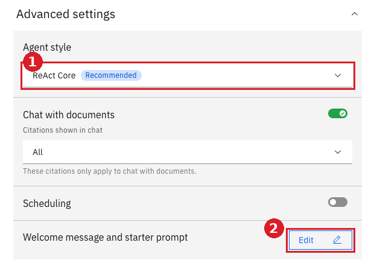

2. Na janela **Edit home page** você pode configurar a mensagem de boas-vindas e os atalhos (**Quick start prompts**) que aparecem como botões para o usuário. <b>Este passo é opcional.</b>

   - **Welcome message** (1), por exemplo:

     ```
     Olá! Sou o Agente de RH da TechCorp. Como posso ajudar você hoje?
     ```

   - **Quick start prompts**: substitua os textos existentes (ou use **Add prompt** (2) / ícone de lixeira) por:

     ```
     Consultar saldo de folgas
     ```
     ```
     Solicitar folga
     ```
     ```
     Atualizar meu endereço
     ```

   - Clique em **Apply** (3).

   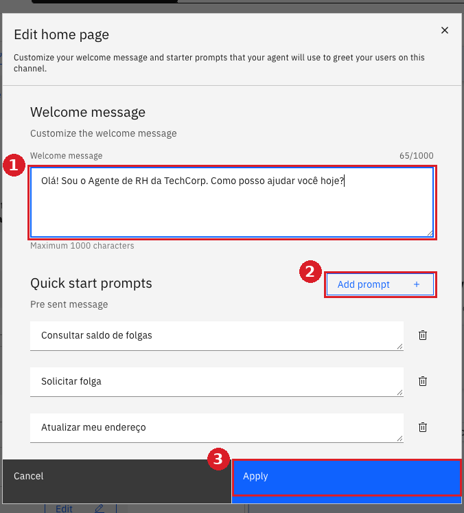

   > [!TIP]
   > Para ver as mudanças no **Draft Preview** (painel da direita), clique no ícone de reiniciar conversa (↻) no canto superior direito do preview. <b>Não é necessário sair da página.</b>

### 4. Adicionar a base de conhecimento

1. Abra a aba **Knowledge** (1) e clique em **Add Source** (2). No preview à direita (A) já aparecem a mensagem de boas-vindas e os atalhos configurados no passo anterior.

   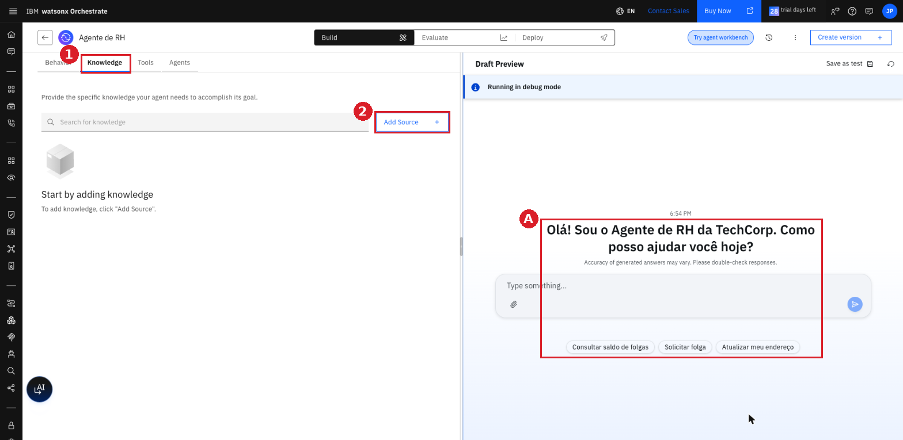

2. Na janela **Add knowledge**, escolha **New knowledge**:

   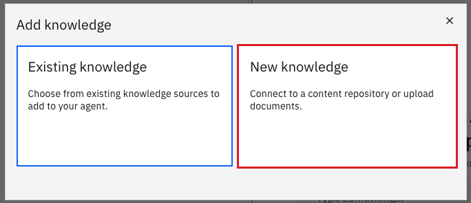

3. Selecione **Upload files** (1) e clique em **Next** (2):

   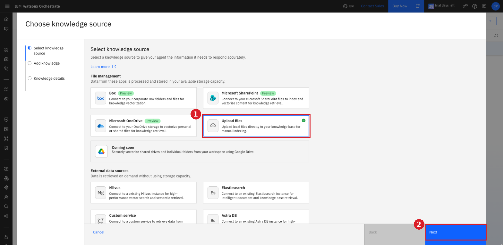

4. Arraste o arquivo [`Employee-Benefits_ptbr.pdf`](lab-data/Employee-Benefits_ptbr.pdf) (ou clique na área tracejada para selecioná-lo) (1) e clique em **Next** (2):

   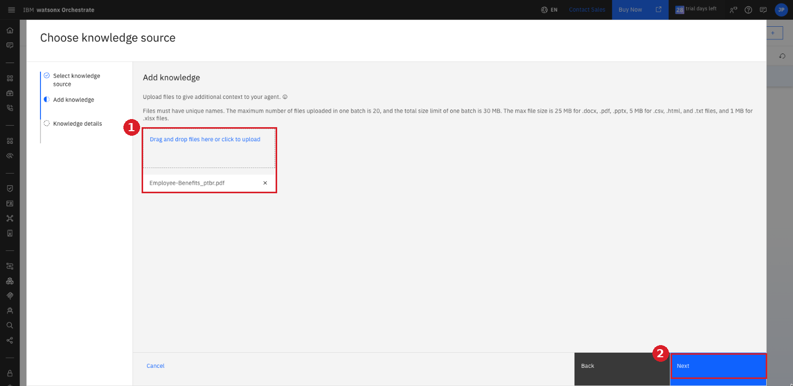

5. Em **Knowledge details**, preencha e clique em **Save** (3):

   - **Name** (1):

     ```
     Pacote de Beneficios-kb
     ```

   - **Description** (2):

     ```
     Esta base de conhecimento aborda os benefícios dos funcionários da empresa, incluindo licença parental, política de animais de estimação (pet-friendly), modelos de trabalho flexíveis, auxílio de bem-estar e auxílio para pagamento de empréstimo estudantil.
     ```

   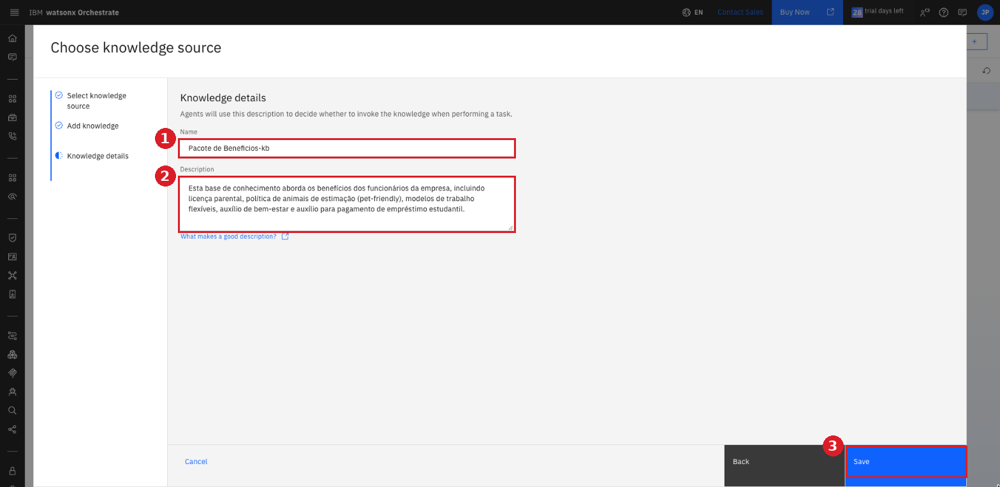

   > [!NOTE]
   > O agente usa a **descrição** para decidir quando consultar a base de conhecimento. Por isso ela deve explicar claramente que tipo de pergunta o documento responde.

6. A base de conhecimento aparece na aba **Knowledge**. Aguarde alguns segundos até o processamento (indexação) do arquivo terminar:

   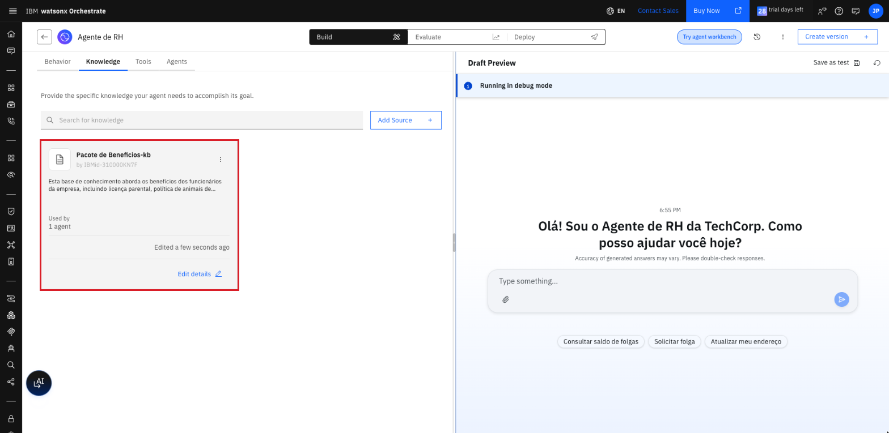

### 5. Adicionar as ferramentas (OpenAPI)

1. Abra a aba **Tools** (1) e clique em **Add Tool** (2):

   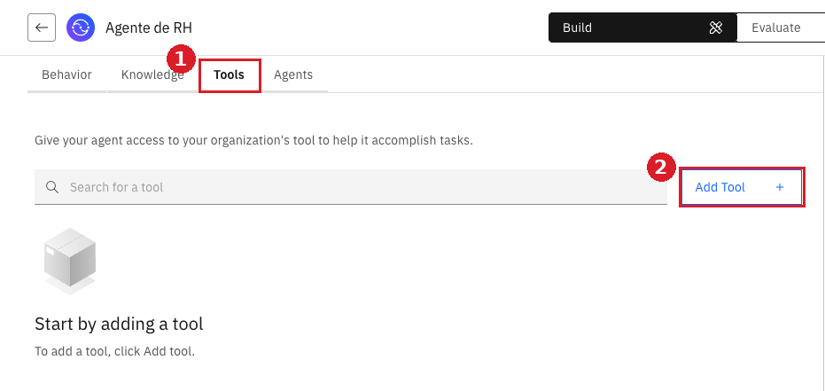

2. Na janela **Add a tool**, na seção **Add from**, escolha **OpenAPI**:

   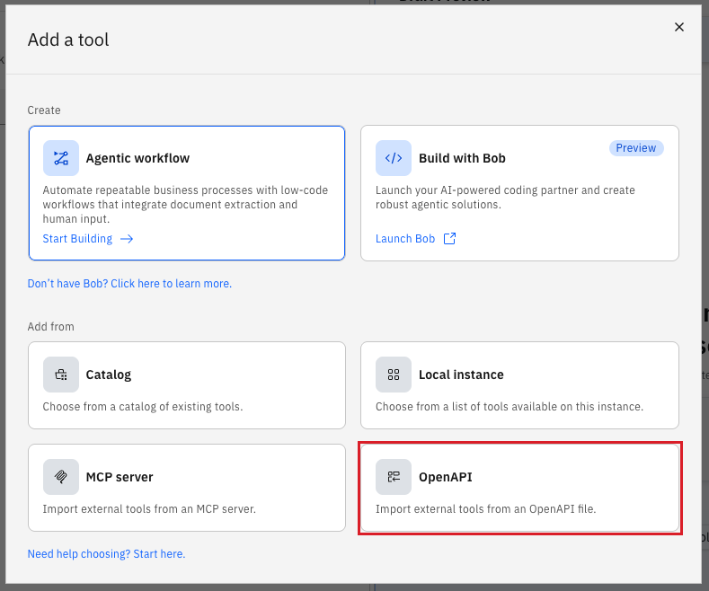

3. Arraste o arquivo [`hr.yaml`](lab-data/hr.yaml) (ou clique para selecioná-lo). Aguarde a mensagem **Validation successful** (1) e clique em **Next** (2):

   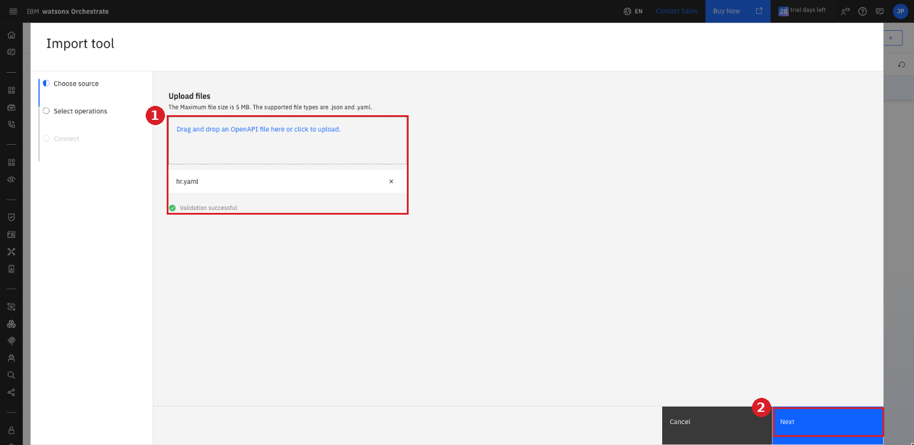

4. Em **Select operations**, marque as **cinco primeiras** operações (1) e **deixe desmarcada** a operação **Criar usuário** (2). Depois clique em **Done** (3):

   - Obter perfil do usuário
   - Obter saldo de folgas
   - Solicitar folga
   - Atualizar cargo
   - Atualizar endereço

   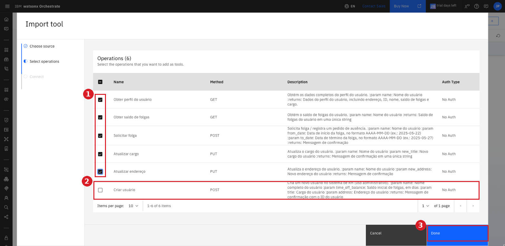

   > [!IMPORTANT]
   > **Por que não importar todas as operações?** Um serviço (ou servidor MCP) pode expor muito mais operações do que o seu agente precisa. Aqui, **Criar usuário** é uma função administrativa que um funcionário não deveria executar pelo chat. Mantenha o agente enxuto, só com as ferramentas que ele realmente vai usar:
   >
   > - **Segurança e governança:** o agente não consegue executar ações que não estão no escopo dele (princípio do menor privilégio).
   > - **Precisão:** com menos ferramentas parecidas, o modelo erra menos ao escolher qual chamar.
   > - **Custo e desempenho:** cada ferramenta adiciona contexto ao prompt do modelo. Menos ferramentas significam respostas mais rápidas e baratas.

5. As cinco ferramentas aparecem na aba **Tools**:

   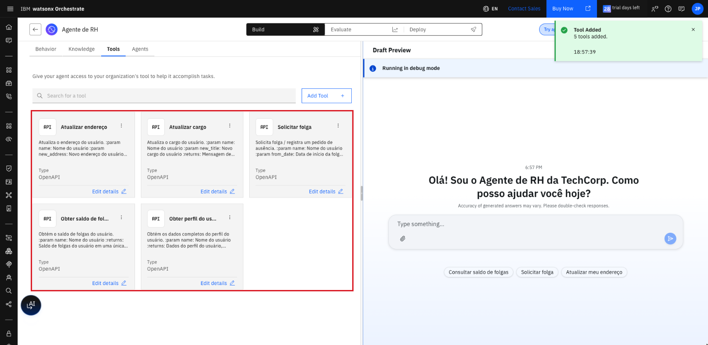

   > [!TIP]
   > Clique em **Edit details** em uma ferramenta para ver o nome, a descrição e os parâmetros que o agente usa para decidir quando e como chamá-la. O nome exibido e a descrição vêm dos campos `summary` e `description` do `hr.yaml`, e o nome interno da ferramenta (que aparece em **Show Reasoning**) vem do `operationId`, por exemplo `solicitar_folga`.

### 6. Definir as instruções do agente

1. Volte para a aba **Behavior** (1) e preencha o campo **Instructions** (2) com o texto abaixo. O campo é salvo automaticamente quando você clica fora dele.

   ```
   Use a base de conhecimento para responder a perguntas gerais sobre os benefícios dos funcionários.

   Use as ferramentas para obter ou atualizar informações específicas do usuário.

   Quando o usuário pedir pela primeira vez para ver os dados de perfil, consultar o saldo de folgas, atualizar o cargo ou o endereço, ou solicitar folga, pergunte primeiro o nome do usuário. Depois chame a ferramenta e use o mesmo nome durante toda a sessão, sem perguntar novamente.

   Quando o usuário solicitar folga, converta as datas para o formato AAAA-MM-DD antes de chamar a ferramenta Solicitar folga. Por exemplo, 22/05/2025 deve ser enviado como 2025-05-22.

   Responda sempre em português do Brasil.
   ```

   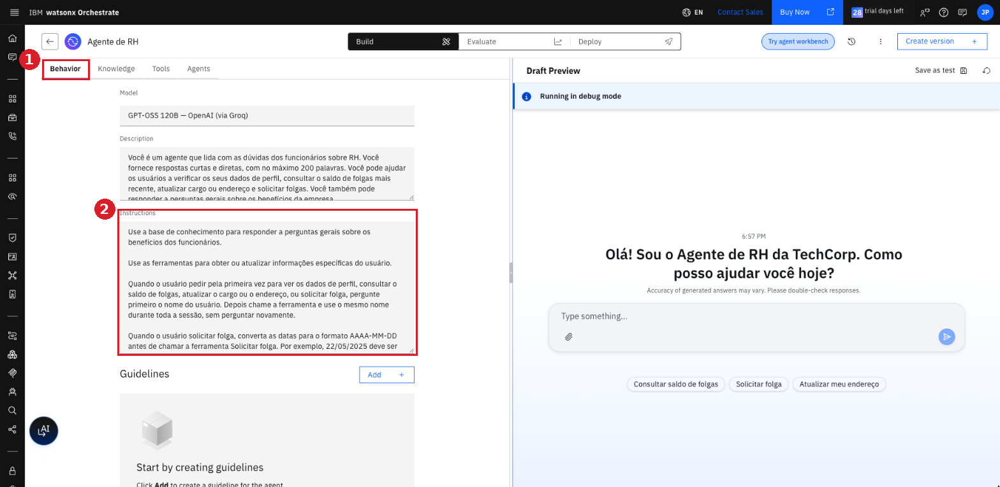

### 7. Testar o agente no Draft Preview

Para esta parte, escolha **um nome de funcionário** da planilha [`users_data.xlsx`](lab-data/users_data.xlsx) (ou da lista fornecida pelo seu instrutor) e use o mesmo nome durante toda a sessão.

Reinicie a conversa do **Draft Preview** (ícone ↻) e faça as perguntas abaixo. As respostas devem ser parecidas com as das imagens.

```
Qual é a política de animais de estimação?
```

A resposta vem da base de conhecimento e mostra a citação do documento `Employee-Benefits_ptbr.pdf`:

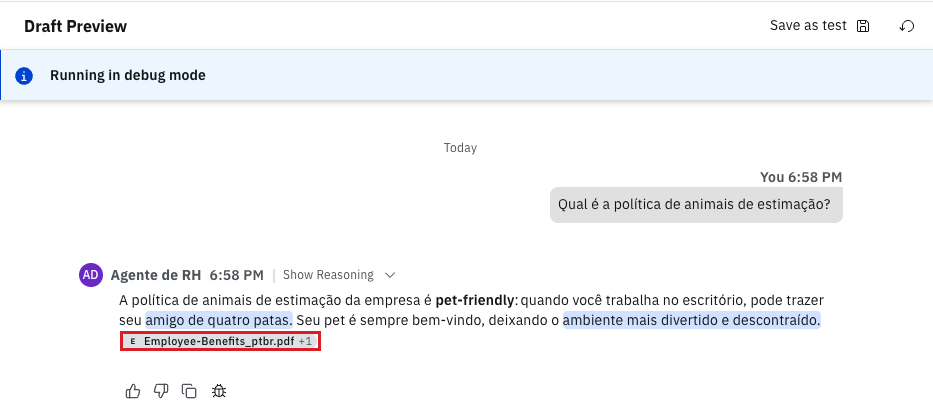

> [!TIP]
> Clique em **Show Reasoning** abaixo do nome do agente para ver quais ferramentas ou bases de conhecimento ele usou em cada passo, com os parâmetros de entrada e a resposta recebida.

Em seguida, teste as ferramentas com os prompts abaixo, **na mesma conversa**:

```
Mostre meus dados de perfil.
```

Na primeira vez, o agente pergunta o seu nome. Informe o nome escolhido (no exemplo, `Daniel Anderson`):

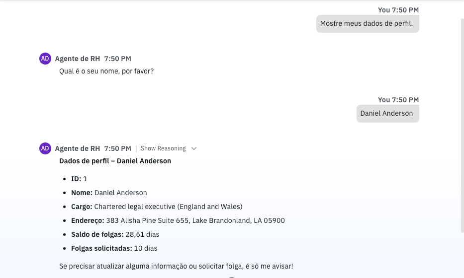

```
Gostaria de atualizar meu cargo.
```

O agente já sabe o seu nome e pergunta só o novo cargo:

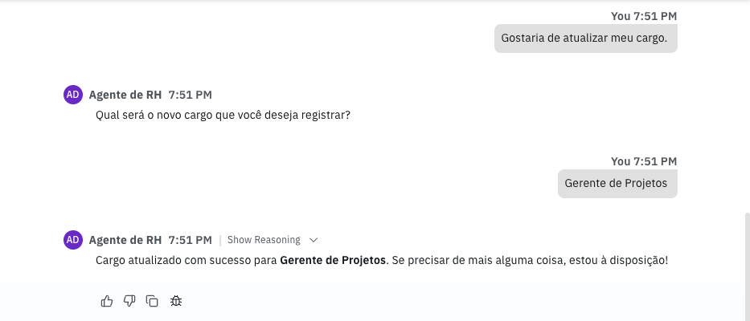

```
Atualizar meu endereço
```

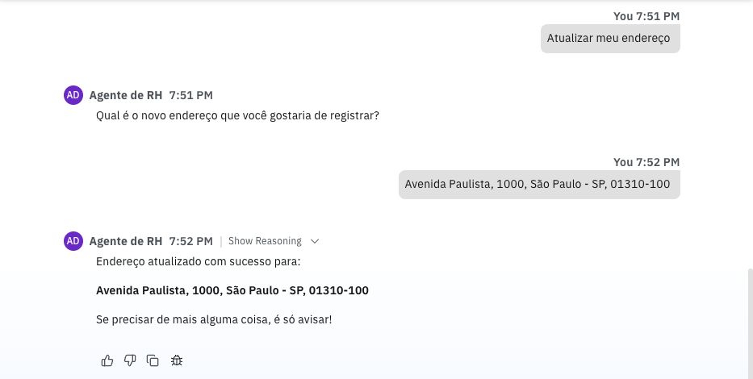

```
Qual é o meu saldo de folgas?
```


```
Solicitar folga
```

Informe as datas no formato brasileiro (por exemplo, `De 21/12/2026 a 23/12/2026`):

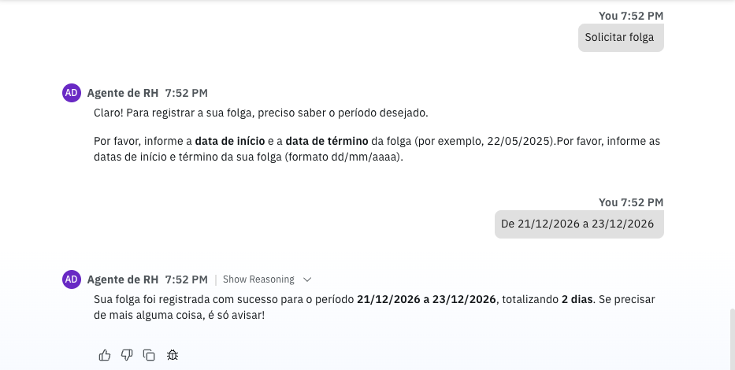

Abra **Show Reasoning** na resposta para ver a ferramenta chamada (1) e as datas já convertidas para o formato `AAAA-MM-DD` (2), como pedimos nas instruções do [passo 6](#6-definir-as-instruções-do-agente):

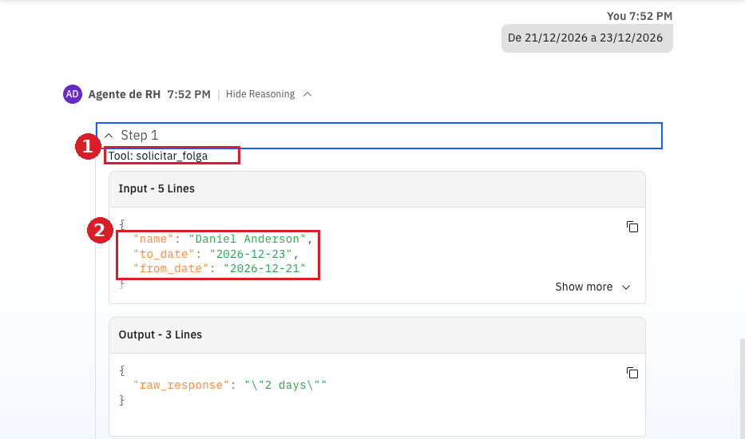

```
Mostre meus dados de perfil.
```

O perfil agora mostra o cargo, o endereço e a folga solicitada que você acabou de registrar:

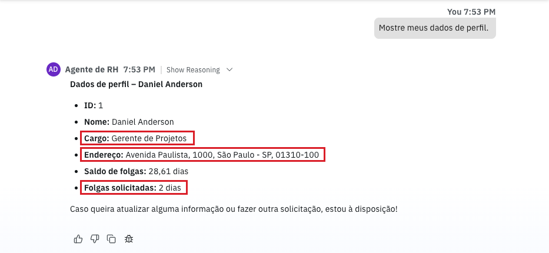

> [!NOTE]
> As ferramentas chamam o simulador de HCM definido em `servers.url` do `hr.yaml`. Se o agente responder que não conseguiu acessar os dados, abra **Show Reasoning**: se a saída da ferramenta mostrar um erro de conexão, o simulador está indisponível. Avise o instrutor.

### 8. Publicar o agente (Deploy)

Até aqui você testou a versão de rascunho (**Draft**) do agente. Para que ele apareça no **Chat** do watsonx Orchestrate, é preciso criar uma **versão** e publicá-la no ambiente **Live**.

1. Clique em **Deploy** (1) na barra superior. Em **Draft Summary**, clique em **Deploy to Live** (2). Em **Channels**, o canal **Orchestrate chat** (3) já vem configurado para exibir o agente na página do Chat.

   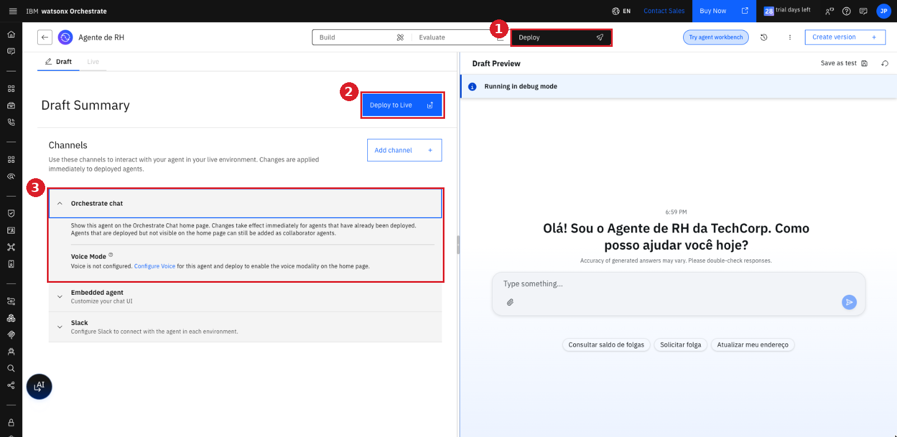

2. Como o agente ainda não tem versões, clique em **Create new version**:

   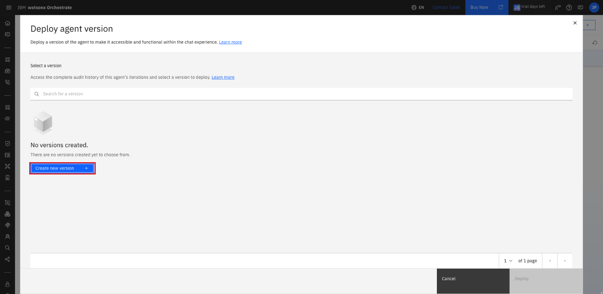

3. Preencha os dados da versão (1) e clique em **Create** (2):

   - **Version name**: `Agente de RH v1`
   - **Description (optional)**: `Primeira versão do lab Ask-HR`
   - **Version number**: `1.0.0`

   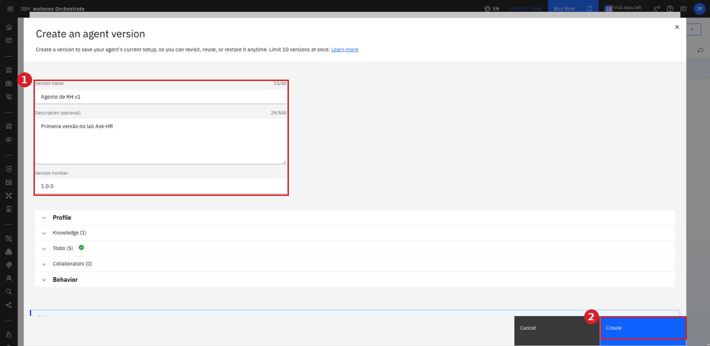

   > [!NOTE]
   > A versão é uma "foto" da configuração do agente (perfil, conhecimento, ferramentas e comportamento). Você pode criar novas versões depois e voltar para uma anterior se precisar.

4. Selecione a versão **1.0.0** (1) e clique em **Deploy** (2):

   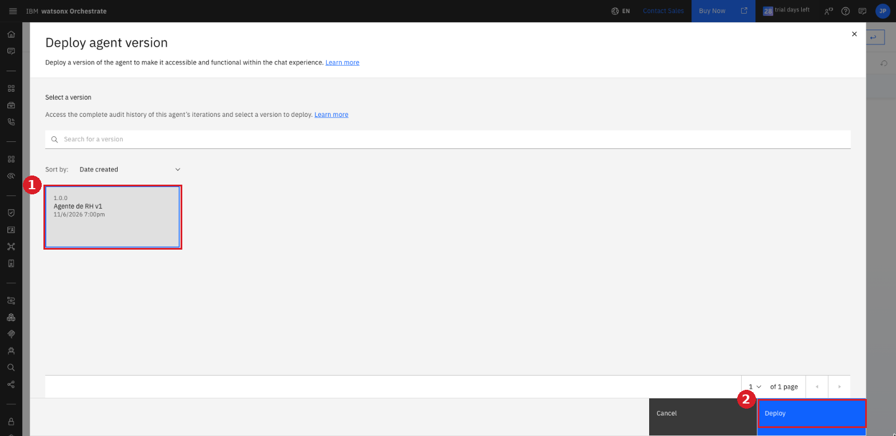

5. Revise o **Pre-deployment summary** e clique em **Deploy**:

   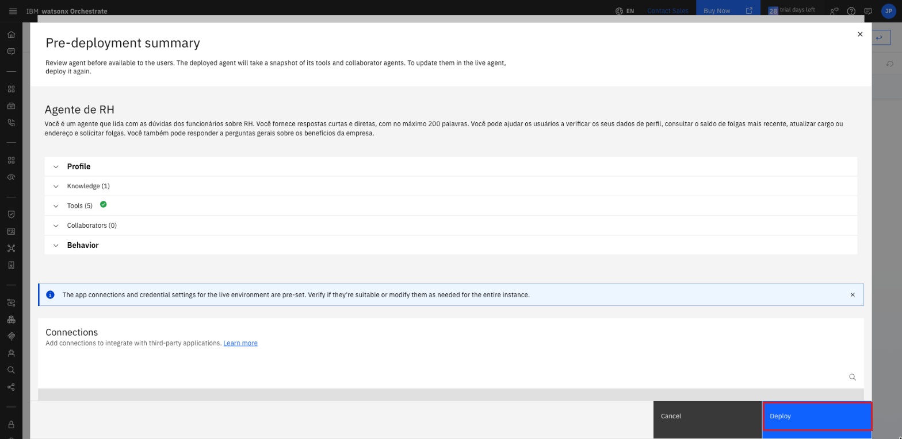

6. Aguarde a mensagem **Version deployed**. O agente passa a exibir o selo **Live** ao lado do nome:

   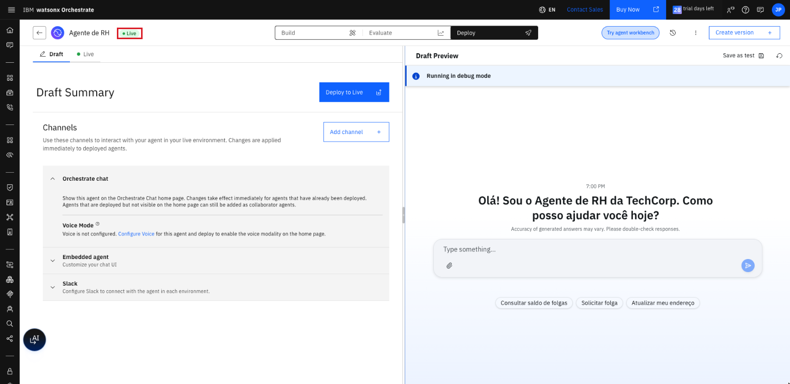

### 9. Testar o agente no Chat

1. Abra o menu principal (ícone ☰ no canto superior esquerdo) e clique em **Chat**:

   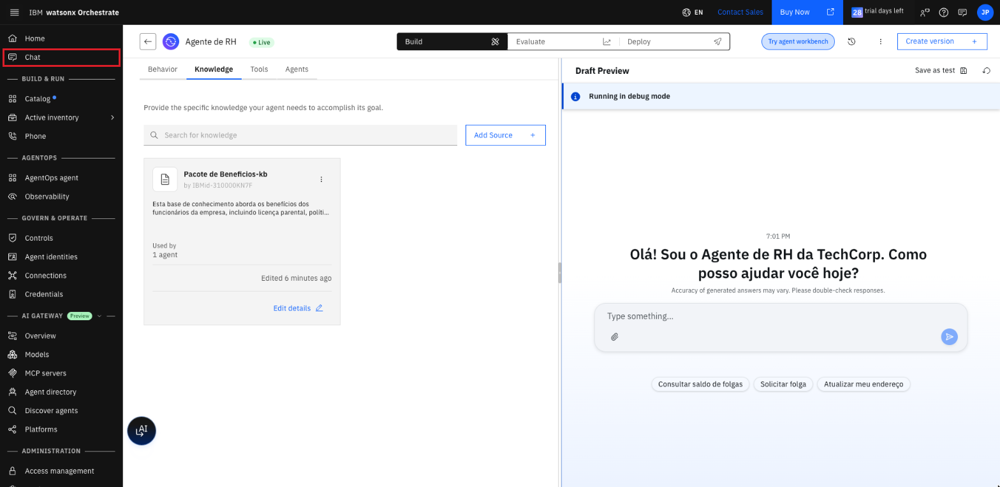

2. Confirme que o **Agente de RH** está selecionado no seletor de agentes, dentro da caixa de mensagem:

   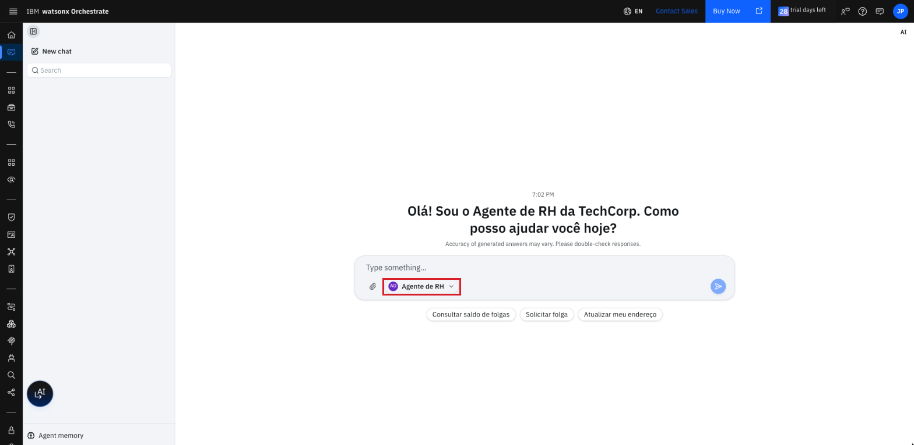

3. Faça perguntas ao agente, por exemplo:

   ```
   A empresa oferece algum auxílio para montar o home office?
   ```

   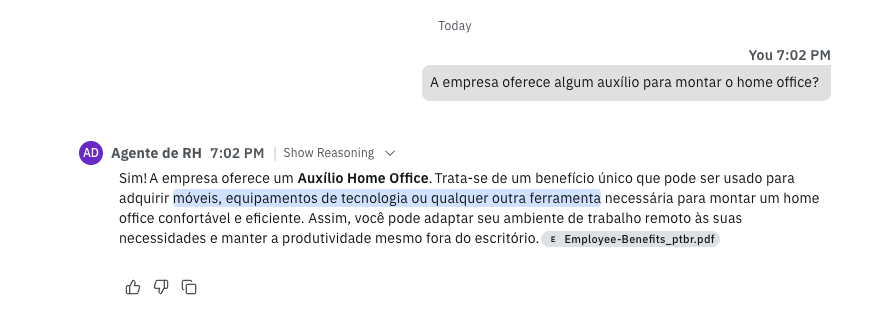

   Repita também os testes de ferramentas do [passo 7](#7-testar-o-agente-no-draft-preview).

🎉 Parabéns! Você criou, testou e publicou um agente de RH com base de conhecimento e ferramentas no watsonx Orchestrate.
